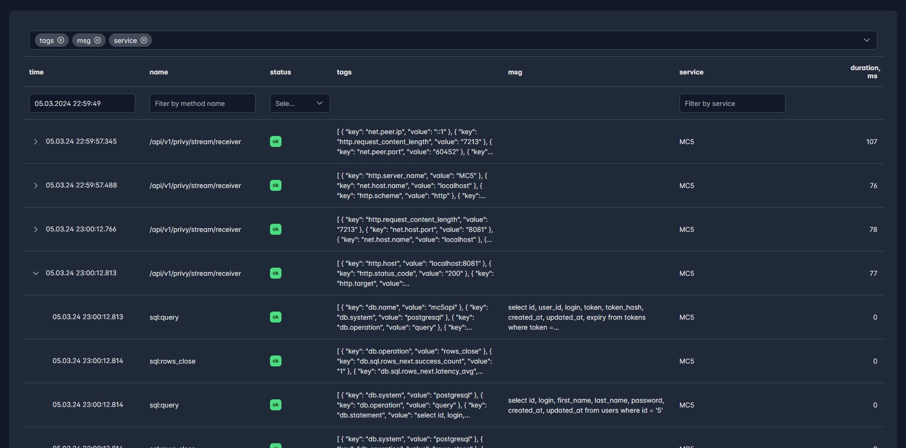
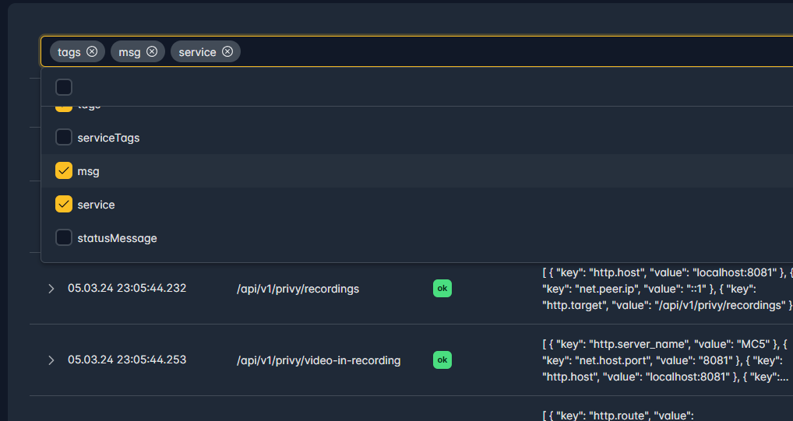
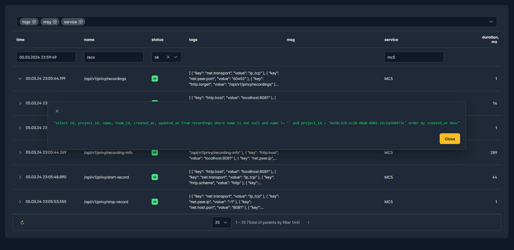
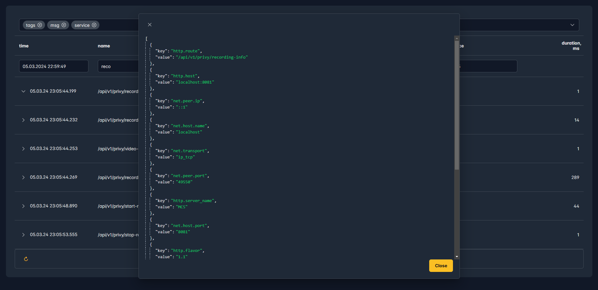

# Troubleshooting

Troubleshooting is an observability system designed to help you efficiently troubleshoot issues within your applications by logs and traces in one window. 
Check if your system make optimal sql-requests, maybe you want to find  excess backend calls. And sure, use it for local debugging your web-services

Stack info
------
* Storage: Clickhouse
* Tracer: opentelemetry
* Logger: zerolog through log-sender (correlated with the active span)
* Communication: gRPC for log and tracing sender, restAPI for UI-backend requests
* UI: vue3 + typescript
* Backend: golang

Some interesting specific
------
* Cursor navigation on UI betwwen pages
* Three days for store of data in storage. Old data erased by clickhouse mehanism

Status
------
Troubleshooting is currently at MVP stage. In progress: testing, updating documentation, improving build/deploy. If you're looking to hire someone to build an awesome troubleshooting/observability/monitoring system, ping me here.

Quick start
------
```
git clone https://github.com/agerimex/troubleshooting.git
cd troubleshooting
make all      # builds the images and creates the troubleshooting_network network; safe to repeat
make up       # starts the stack (docker compose up -d --wait)
open url localhost:8095
```

`make all` only builds; it doesn't start anything. `make down` stops the stack and keeps the data.

ClickHouse keeps its data in the named volume `troubleshooting_clickhouse-data`, so it survives `docker compose down`, `up` and container recreation; only `docker compose down -v` (or `docker volume rm`) deletes it. Installations from before this volume existed kept their data in an anonymous volume, which is not carried over. On Docker Desktop the very first start of ClickHouse on an empty volume can take several minutes; `make up` waits for it.

Investigating a failure
------
The UI has five pages (the product blueprint, `docs/product-blueprint.md`): **Log Analysis**, **Timeline & Sequence**, **Problems**, **Releases** and **Settings**. An investigation ends in one **report**: one trace's spans and its correlated log records together, within an explicit time window.

1. Find an entry record:
   * **Log Analysis** (the default page): set the window (From/To; an empty To means now) and filter spans by name, status or service. As soon as you filter, the search covers spans at **any depth**, so a failed step under a successful request is found; "Root spans" lists only trace roots. Expanding a span shows its child spans and the log records that recorded exactly that span, inline in the same table and in time order; trace-level logs and logs naming an unknown span are a separate group under the root span. Filters select spans; they never search log text, and an OK span keeps its ERROR logs. The row's "⋯" button, right-click or the keyboard offer **Open timeline**, **Open sequence** and **Copy investigation link**.
   * **Timeline & Sequence**: open a trace by its id, or list the executions whose entry span started in a window (filters on the entry span's service, name and status; 50 per page).
   * **Problems**: a recurring error group or slow call has retained examples; each opens in Timeline & Sequence. A log without a recorded TraceId can be inspected but opens no report: a SpanId or a timestamp alone never identifies a trace.
2. The report keeps the window of where it was opened and takes only the trace from the entry record: filters don't narrow it, and the record it was opened for is selected. It shows:
   * the scope (one trace, the window, when it was generated) and whether it is **Complete** or **Incomplete**, with the reasons; "Back to …" returns to the page it was opened from, as it was;
   * **Timeline** (default): every span on one time axis in parent order, with status and duration, and "parent missing" when a parent isn't in the report ("Widen by 1 h on each side" regenerates with a wider window); or **Sequence**: calls between services as arrows (a CLIENT span with exactly one SERVER child of another service), operation starts and ends, and ERROR log markers. The last chosen view is remembered;
   * next to it the selected span's logs (as task lanes or a list) or **All trace logs**, each with its log severity and association: the span it recorded, "No span identifier recorded", or "Referenced span not found within the window". A log is never attached to a span by its time. The span's events (exception type, message, stack trace) and links are one click away; a linked trace is marked "not inspected" and can be opened as its own report.
3. Each source has its own status. If spans or logs could not be read (database unavailable, query limit or timeout), that section says so and offers Retry; it is never shown as zero records, and the report is Incomplete. A section cut at its limit says how many records are shown and that more match. A window older than the retention period warns that records may have expired.
4. **Export HTML** or **Export JSON** saves the report as displayed (not a new query), including its limitations, the full trace whatever is selected, the view and the generation time. The HTML file has no scripts and shows recorded text as text. **Regenerate** queries again. **Investigation link** gives a link with the trace, window and selection (no log text); opening it generates the report again.

A span's status and a log's severity are what the application recorded. A successful span is not proof that the business task behind it succeeded, and a complete report does not prove every event was instrumented or delivered. A report covers one trace; other traces of the same business operation are not merged into it.

How to intergate to your golang project
------
```
go get github.com/agerimex/troubleshooting/log-sender
go get github.com/riandyrn/otelchi
go get github.com/uptrace/opentelemetry-go-extra/otelsql
go get go.opentelemetry.io/otel/semconv/v1.20.0
```

* example for go-chi

```
package main
...
import (
...
    sender "github.com/agerimex/troubleshooting/log-sender"
...
)
...
func initOpenTelemetry() {
	_, err := sender.NewTracer("Test",
		sender.WithAddress("localhost:50055"),
		// sender.WithToken("..."), // or TROUBLESHOOTING_TOKEN env, if the receiver requires a token
	)
	if err != nil {
		fmt.Println("Where is receiver of traces")
	}
}
...
func main() {
...
    initOpenTelemetry()
    defer sender.Shutdown(context.Background()) // flushes spans still in the buffer
... 
}
```

If the receiver is unavailable, spans are dropped and the error is logged through OpenTelemetry; your application keeps running. (`flag.Set("addrTrace", ...)` from older versions still works.)

* routing
```
func (app *application) routers() http.Handler {
	mux := chi.NewRouter()
	mux.Use(middleware.Recoverer)
	mux.Use(otelchi.Middleware("LOG", otelchi.WithChiRoutes(mux)))
	mux.Use(cors.Handler(cors.Options{
		AllowedOrigins:   []string{"https://*", "http://*"},
		AllowedMethods:   []string{"GET", "POST", "PUT", "DELETE", "OPTIONS"},
		AllowedHeaders:   []string{"Accept", "Authorization", "Content-Type", "X-CSRF-Token"},
		ExposedHeaders:   []string{"Link"},
		AllowCredentials: true,
		MaxAge:           300,
	}))

	return mux
}
```

Sending logs
------
Logs go to the same receiver address. Each record carries the trace id and span id of the span active when it was written, so the report can show it with that span.

```
exporter, err := sender.NewLogExporter("orders-api", sender.WithAddress("localhost:50055"))
...
w := sender.NewLogWriter(exporter, time.Second) // sends in the background every second
defer w.Close(context.Background())             // final flush
logger := zerolog.New(io.MultiWriter(os.Stdout, w)).Hook(sender.TraceHook{})

logger.Error().Ctx(ctx).Msg("Storage returned 403 AccessDenied") // ctx holds the current span
```

* `TraceHook` adds `trace_id`, `span_id` (only when `ctx` has a span), a `record_id` and a precise time; other fields become attributes.
* Delivery is confirmed: the receiver answers only after the records are stored. `LogWriter` keeps unconfirmed records and retries them with the same `record_id`, so a retry is stored once in reports. Its buffer holds 10 000 records; when the receiver is down longer, the oldest are dropped and counted (`Dropped()`); `Err()` is the last delivery error.
* Without zerolog: `exporter.Send(ctx, []sender.LogRecord{sender.NewLogRecord(ctx, "ERROR", "...")})` returns nil only after the receiver stored them; on an error, send the same records again.
* Older senders that only set a message and a time still work; their records have no correlation and no severity.

Send traces from any language (OTLP)
------
The receiver also accepts the standard OpenTelemetry protocol (OTLP over gRPC) on port 4317, so any application instrumented with an OpenTelemetry SDK (Go, Java, Python, Node.js, .NET, …) or an OpenTelemetry Collector can send traces without log-sender. Usually environment variables are enough:

```
OTEL_EXPORTER_OTLP_ENDPOINT=http://localhost:4317
OTEL_EXPORTER_OTLP_PROTOCOL=grpc
OTEL_SERVICE_NAME=orders-api
# if the receiver requires a token:
OTEL_EXPORTER_OTLP_HEADERS="authorization=Bearer <token>"
```

Only traces over gRPC are supported for now (not OTLP/HTTP on port 4318, not logs or metrics). Some SDKs, e.g. Node.js, default to HTTP, so set the protocol explicitly.

Configuration
------
All settings are environment variables; docker-compose reads them from the shell or a `.env` file next to `docker-compose.yml`. Everything works without them.

| Variable | Used by | Default |
| --- | --- | --- |
| `CLICKHOUSE_ADDR` | receiver, analysis | `clickhouse-server:9000` (`localhost:19000` when running a service outside Docker) |
| `CLICKHOUSE_DATABASE`, `CLICKHOUSE_USER`, `CLICKHOUSE_PASSWORD` | ClickHouse, receiver, analysis | `default`, `default`, empty |
| `LISTEN_ADDR` | receiver, analysis | `:50055`, `:8094` |
| `OTLP_LISTEN_ADDR` | receiver (OTLP/gRPC) | `:4317` |
| `TRACE_RECEIVER_ADDR` | analysis (its own traces) | `log-receiver-compose:50055` |
| `CORS_ALLOWED_ORIGINS` | analysis | `http://localhost:5173,http://127.0.0.1:5173` (Vite dev server) |
| `APP_ENV` | analysis | empty; `development` pretty-prints JSON |
| `TROUBLESHOOTING_TOKEN` | receiver (both ports), log-sender | empty = no token check |
| `UI_AUTH`, `UI_USER`, `UI_PASSWORD_HASH` | UI (Caddy) | `off` |
| `QUERY_TIMEOUT` | analysis: ClickHouse `max_execution_time` per query (a request runs at most two) | `10s` |
| `QUERY_MAX_ROWS_TO_READ` | analysis: ClickHouse `max_rows_to_read` per query | `50000000` |
| `QUERY_MAX_MEMORY_BYTES` | analysis: ClickHouse `max_memory_usage` per query | `1073741824` (1 GiB) |
| `MAX_SEARCH_WINDOW` | analysis: widest allowed `time_from`..`time_to` | `96h` (the 3-day retention plus a day) |
| `TRACE_RETENTION`, `LOG_RETENTION` | receiver: raw retention of spans and logs (Go duration or `7d`), applied to existing tables on startup; it must be longer than 1 h bucket + allowed lateness + 1 h rebuild margin, or the receiver refuses to start | `72h` |
| `STATS_RETENTION` | receiver: retention of statistics, coverage records and saved comparisons | `720h` (30 days) |
| `STATS_ALLOWED_LATENESS` | receiver and analysis (set both the same): how long after a bucket ends a record may still arrive and count in it | `24h` |
| `STATS_REFRESH_INTERVAL`, `STATS_REFRESH` | analysis: how often completed buckets are rebuilt; `off` disables the refresher | `1m`, on |
| `SAMPLING_POLICY_DEFAULT` | analysis: sampling policy of spans that declare none (`unsampled`, `head:0.2`); empty = unknown, which withholds change signals | empty |
| `TEST_CLOCK_CONTROL` | analysis: `1` enables the test clock and failure controls of the regression fixture; never on a real installation | off |

The API reads the retention ClickHouse really applies from the table definitions (`GET /api/v1/retention`), so report warnings and statistics can't disagree with it. Expired data is removed by ClickHouse in the background, whole parts at a time; a longer retention can't restore what was already deleted.

A query that hits a limit, or a request that hits its deadline (2 × `QUERY_TIMEOUT` + 2 s), fails with HTTP 504 and a message naming the limit, and an unreachable ClickHouse gives HTTP 503 ("the database is unavailable"); the API never returns a partial result as if it were complete. A request the browser abandons cancels its queries.

Security
------
By default there is no authentication, which is convenient for local debugging. ClickHouse and the API port are published on `127.0.0.1` only; the UI (8095) and the receiver (50055, 4317) are reachable from the network. On a shared server, turn on:

* Basic auth for the UI and API: `UI_AUTH=basic`, `UI_USER=<name>`, `UI_PASSWORD_HASH=<hash>` where the hash comes from `docker run --rm caddy:2 caddy hash-password --plaintext '<password>'`. In `.env`, wrap the hash in single quotes because it contains `$`.
* A shared token for the receiver: `TROUBLESHOOTING_TOKEN=<random string>` for the receiver and every application that sends traces. The token travels unencrypted (no TLS), so it keeps out stray senders, not someone who can watch the network.
* A password for ClickHouse: `CLICKHOUSE_PASSWORD`.

Span API
------
`POST /api/v1/view-spans` returns `{"Spans": [...], "HasMore": bool}`; `POST /api/v1/count-spans` returns `{"Count": n}` for the same filter. Body (JSON):

| Field | Meaning |
| --- | --- |
| `time_from`, `time_to` | Required. Half-open window `[time_from, time_to)`, Unix nanoseconds as strings: a span starting exactly at `time_to` is not in it. Lists, counts and child counts only see spans that start inside it. |
| `scope` | `root` (root spans) or `all` (any depth). Default: `root`, or `all` with `trace_id`. |
| `trace_id` | 32 hex digits: only this trace. |
| `parent_id` | 16 hex digits: children of this span. Needs `trace_id`, because span ids are unique only within a trace. |
| `status`, `service_name`, `method_name` | `unset`/`error`/`ok`; case-insensitive substrings of the service and span name. |
| `rows_per_page` | Default 25, at most 1000. `HasMore` says whether more rows follow (read with one extra row, not guessed). |
| `after_time`, `after_trace_id`, `after_span_id` | Cursor: the last row of the previous page; all three or none. Rows are ordered by (start time, trace id, span id). |

Rules every endpoint shares:

* A span is identified by (trace id, span id); its children by (trace id, parent span id).
* **Canonical record.** A span may be stored more than once (exporter retries, or a span sent twice). Reads pick one whole stored row per (trace id, span id) among its rows in the window, before any filter applies, so lists, trace views, child counts and totals agree and retries don't change them. For conflicting payloads the winner is, in order: error status; more events; more links; the larger hash of all other columns (independent of arrival order). Duplicates still exist in storage; only reads are deduplicated.
* Each span comes with `events` (`timeUnixNano`, `name`, `attributes`) and `links` (`traceId`, `spanId`, `traceState`, `attributes`), and `childSpanCount`: its children in the window.
* Paging is exact for data that doesn't change meanwhile; spans that arrive during paging may or may not appear (no snapshot). Refresh starts over.

Log and report API
------
`POST /api/v1/search-logs` returns `{"Logs": [...], "HasMore": bool}`. Body: `time_from`, `time_to` (required, `[from, to)`, Unix ns strings), optional `trace_id`, `service_name` and `message` (case-insensitive substrings, no wildcards), `severity` (exact, e.g. `ERROR`), `rows_per_page` (default 25, at most 1000) and the cursor `after_time` + `after_record_id`. A record is `timeUnixNano`, `recordId`, `traceId`, `spanId` (empty = not recorded), `severity`, `service`, `message`, `attributes`. Retries of one record (same `recordId`) are read once.

`POST /api/v1/trace-report` builds the report of one trace. Body: `trace_id`, `time_from`, `time_to` (required), `span_limit`, `log_limit` (default and maximum 1000), `sections` (`["spans"]` or `["logs"]` to retry one; default both). It answers `{"Report": {...}}` with HTTP 200 even when a source failed: each of `spans` and `logs` has `status` (`ok`, `unavailable`, `limit`, `error`), `error`, `records`, `shown`, `limit`, `truncated`, `total` (null if counting failed) and `totalStatus`; plus `warnings` (e.g. retention), `generatedAt` and `complete`.

Testing
------
```
make test             # Go unit tests of every module, UI type-check and unit tests
make ui-e2e           # browser checks of the UI against a mocked API (Playwright)
make test-stack-up    # isolated test stack (own project, ports and volume), then:
make fixture-load     # load a fresh regression fixture run
make fixture-check    # check it, incl. replay, database outage and container recreation
make test-stack-reset # delete the test stack and its volume (never the dev stack)
```
See [fixtures/regression/README.md](fixtures/regression/README.md) for the scenarios and expected answers. CI (`.github/workflows/ci.yml`) runs all of these.

Versions
------
Builds and CI use Go 1.21.13, Node 20.18.0 (UI build), ClickHouse 26.9.13.15 and Caddy 2.8.4; the UI's dependencies are pinned by `log-ui/package-lock.json` (`npm ci`).

Coming soon
------
* Search by sql (text and parameters)
* search by duration

Statistics and release comparison
------
Milestone 2 (`features/milestone_2`): call counts, error fractions, latency percentiles and error groups of an explicitly selected population, compared between two releases or windows, with examples that open the combined trace report. In the UI: **Statistics** and **Compare releases**.

**Population.** A recorded call is one canonical span of one service that started in a half-open window `[time_from, time_to)`. Operation (span name), span kind, environment, version, installation and workload segment are optional filters; a missing value is its own "not recorded" group and is never borrowed from another span. Without an operation the result has one row per (operation, span kind): SERVER, CONSUMER and CLIENT spans are never summed. Statistics read these attributes (resource or span attributes; on logs, record attributes): `service.version`, `deployment.environment.name`, `troubleshooting.installation`, `troubleshooting.workload_segment`, `troubleshooting.sampling_policy` (`unsampled` or `head:<ratio>`), and `operation.name` on logs. log-sender's `WithResourceAttributes` adds them to spans and logs.

**Metrics** (`metrics-v1`): calls, ERROR/OK/UNSET counts, recorded error fraction, rate per minute over the whole window, and p50/p95/p99 in milliseconds (ClickHouse t-digest, approximate) over valid durations. A span without a valid duration (no end, or end before start; stored as -1) counts as a call but not in percentiles. Percentiles need at least 20/200/1000 valid durations (a heuristic). A failed or expired query is unavailable, never 0.

**Error groups** (`errors-v1`): ERROR-status spans, exception events and ERROR/FATAL logs are separate source kinds and are never added up. Exceptions group by type and application frame; otherwise by the message with UUIDs, long hex ids and request/session/user/order/trace/span/correlation identifiers replaced (numbers such as 403 stay).

**Comparison** (`comparison-v1`): the user chooses baseline and candidate. A latency percentile is a regression or improvement signal when both sides meet its sample minimum and the change is at least 20 ms and 20 %; the error fraction when both sides have 1000 calls and it changes by at least 1 percentage point. Coverage gaps, unknown sampling, conflicting payloads or a population mismatch give "insufficient evidence" or "not comparable" instead. Each comparison is stored as a revision that can be reopened, regenerated (a new revision) and exported as HTML or JSON together with the combined reports the user included.

**Statistics storage.** The API rebuilds each completed UTC hour from canonical raw records and stores it as a new revision (`stat_calls`, `stat_errors`, committed by a row in `stat_revisions`); a failed rebuild leaves the previous revision. A record counts in its bucket only if the receiver got it before bucket end + `STATS_ALLOWED_LATENESS`; after that the bucket is final and never changes, and later arrivals are reported as excluded. Statistics outlive raw records (`STATS_RETENTION`). A query uses, per hour, either the stored revision or raw records, never both; bounds inside an hour need raw records, otherwise the API offers whole-hour bounds. Collection coverage comes from receiver heartbeats (every 15 s) and from declarations (`POST /api/v1/coverage`, e.g. for a known outage or backfilled history).

| Endpoint | Body → result |
| --- | --- |
| `POST /api/v1/stats/calls` | `{population, group_by_version, series}` → `{Stats}`: rows, time series, coverage, plan (stored or raw per hour), notices, cutoff |
| `POST /api/v1/stats/error-groups` | `{population}` → `{ErrorGroups}`, with a status per source (spans, logs) |
| `POST /api/v1/stats/examples` | `{population, kind: slow or error, threshold_ms, group, limit, cutoff}` → `{Examples}` (bounded; unavailable outside raw retention) |
| `POST /api/v1/stats/shapes` | `{time_from, time_to, service, operation, errors_only}` → `{Library}`: execution shapes (entry + distinct calls) with executions, failed share, p50/p95/p99 and representative executions; stored hourly, raw for hours without them (`docs/sequence-library.md`) |
| `POST /api/v1/compare` | `{baseline, candidate, regenerates}` → `{Analysis}` (stored) |
| `GET /api/v1/analyses`, `GET /api/v1/analyses/{id}` | saved comparisons, exactly as generated |
| `POST /api/v1/stats/rebuild` | `{time_from, time_to}` → outcome per bucket; rebuild or backfill now (idempotent) |
| `GET /api/v1/stats/status`, `GET /api/v1/retention` | refresher state and failures; effective retention |
| `POST /api/v1/coverage` | `{source, time_from, time_to, status: complete or gap, reason}` |

Population fields: `service` (required), `operation`, `span_kind`, `environment`, `version`, `installation`, `segment` (omitted = any, `""` = not recorded), `time_from`, `time_to`.

Problems, Releases and Settings
------
**Problems** (from the `troubleshooting-ui-agent` proposal; record: `docs/problem-workspace.md`): for one service and window it lists recurring error groups (headline: distinct affected calls, or matching records with "Call attribution unavailable" when the records name no span), slow calls (distinct calls above the slow-call duration) and release regressions (the p95 change of a stored comparison; no baseline is guessed from version text). A problem's **Investigate** tab has a bounded list of retained examples; the chosen one opens in Timeline & Sequence with its span and log selected. **Compare releases** compares releases of the problem's operation and checks a fix against the affected release and the original baseline. **Releases** holds the release comparison and the operation statistics. **Settings** holds the **detection rules** (three templates: error signals, slow calls, release regressions; every save is a revision, and a save based on an older revision is a conflict) and the effective **data retention** (read-only; set on the receiver). The Sequence view is described in `docs/sequence-investigation.md`; spans in `view-spans` and `trace-report` carry `spanKind`.

| Endpoint | Body → result |
| --- | --- |
| `POST /api/v1/problems` | `{service, environment, time_from, time_to, limit, cursor, rules_revision}` → `{Problems}`: status (available, empty, partial, unavailable, expired), sources, problems with their explanation, `next`, `waiting` |
| `GET /api/v1/problems/services?time_from&time_to` | services with recorded calls (a picker) |
| `GET /api/v1/detection-rules` | the latest revision, or the defaults as revision 0 |
| `POST /api/v1/detection-rules` | `{rules, expected_revision}` → `{Rules}` (the stored revision); 400 `{FieldErrors}`; 409 `{Rules}` with the current revision |

## Open for feature requests, happy for helping with integration, and Welcome to connect for developing an awesome observability system

Screenshots
------

* Full page


* Possible for select a list of colums for view


* Details of SQL request with auto fill parameters


* Details for all http tags for request

